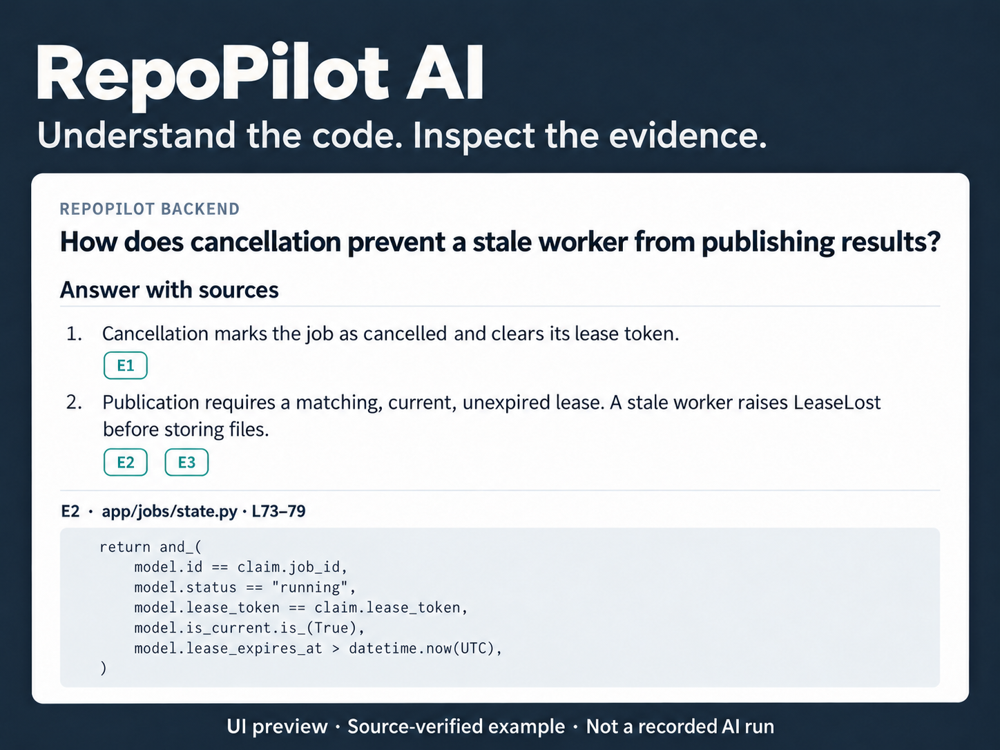
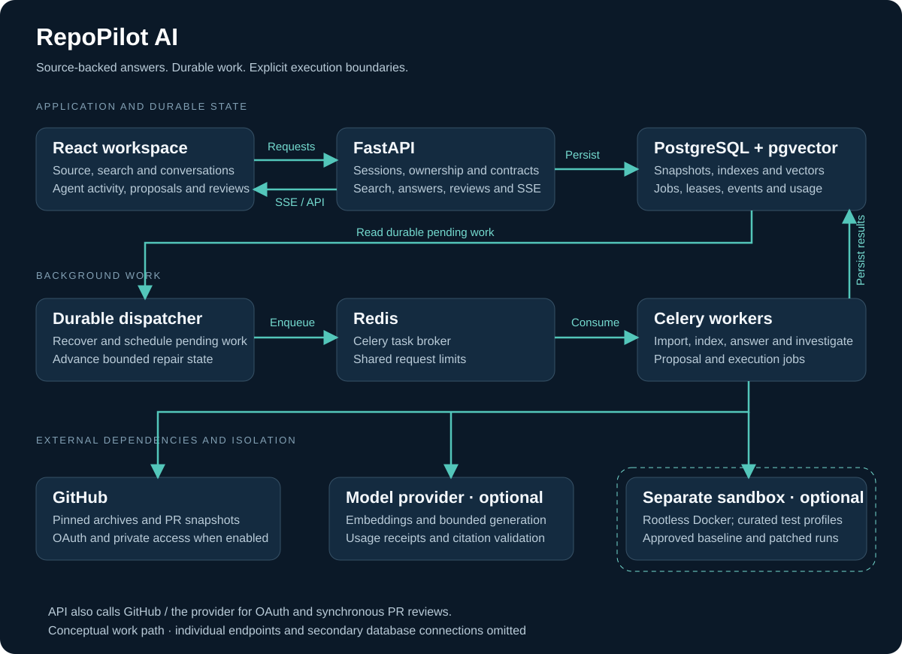

# RepoPilot AI

**An AI workspace for understanding code and reviewing proposed changes.**

RepoPilot helps developers explore GitHub repositories, ask questions with source
citations, and turn investigations into reviewable patches. It brings code search,
AI assistance, and controlled test execution into one full-stack application.

[Quick start](#quick-start) · [Architecture](docs/architecture.md) · [Development](docs/setup.md) · [Validation](docs/project-status.md)



*AI-generated product illustration with an authored example.*

## What it does

- **Explore code:** import public or authorized private GitHub repositories, browse
  files, and search Python and TypeScript/TSX by keywords, symbols, or meaning.
- **Explain with evidence:** ask questions, follow source citations, and return to
  saved conversations with streamed progress.
- **Propose changes:** investigate a task, inspect the agent's activity, and download
  a source-checked patch. Review pull requests against pinned code snapshots.
- **Test with approval:** compare baseline and patched tests in an isolated runner,
  with an optional repair loop limited to two revisions.

## Engineering highlights

| Area | Implementation |
| --- | --- |
| Full-stack development | React, TypeScript, Vite, Python, FastAPI |
| AI and code search | Static parsing, hybrid retrieval, cited answers, bounded agent tools |
| Data and background work | PostgreSQL/pgvector, Redis, Celery, durable jobs and event replay |
| Security and operations | Session authentication, ownership checks, isolated execution, Docker, CI, metrics |

The project demonstrates end-to-end product development: interface design, typed
APIs, database migrations, background processing, AI integration, and automated checks.

## Architecture



FastAPI handles authentication and application logic. PostgreSQL stores code
snapshots and durable job state; Redis and Celery deliver background work.
The browser receives saved progress over Server-Sent Events. Approved test runs
use a separate sandbox host. [Read the design](docs/architecture.md).

## Quick start

Requires Docker with Compose v2.

```bash
git clone https://github.com/salehmmrezaei/repopilot-ai.git
cd repopilot-ai
cp .env.example .env
```

In `.env`, replace `POSTGRES_PASSWORD` and the matching password in
`APP_DATABASE_URL` with the same local password using letters and digits.

```bash
docker compose up --build -d
docker compose ps -a
```

Open [localhost:3000](http://localhost:3000) and create an account with a 15–128
character passphrase. Import a repository, build its source index, and prepare
search. API documentation is at [localhost:8000/docs](http://localhost:8000/docs).

Keyword and symbol search work without an API key. AI answers, semantic search,
GitHub OAuth, and sandbox execution require [optional configuration](docs/setup.md#optional-features).

## Validation and scope

The recorded [CI run from 6 October 2026](https://github.com/salehmmrezaei/repopilot-ai/actions/runs/37426995740)
passed **358 backend tests, 12 infrastructure integration tests, and 69 frontend tests**.
Six sandbox tests were skipped. These are historical test results; live OAuth,
model quality, sandbox isolation, and production operations require separate
environment checks. [Evidence and remaining checks](docs/project-status.md).

Patches and PR reviews remain review artifacts. RepoPilot does not push changes
or post reviews to GitHub.

## Documentation

- [Development and configuration](docs/setup.md)
- [Architecture and design choices](docs/architecture.md)
- [Security and data handling](docs/security.md)
- [Evaluation](docs/evaluation.md)
- [Deployment and operations](docs/deployment-operations.md)
- [Sandbox setup](docs/sandbox.md)
