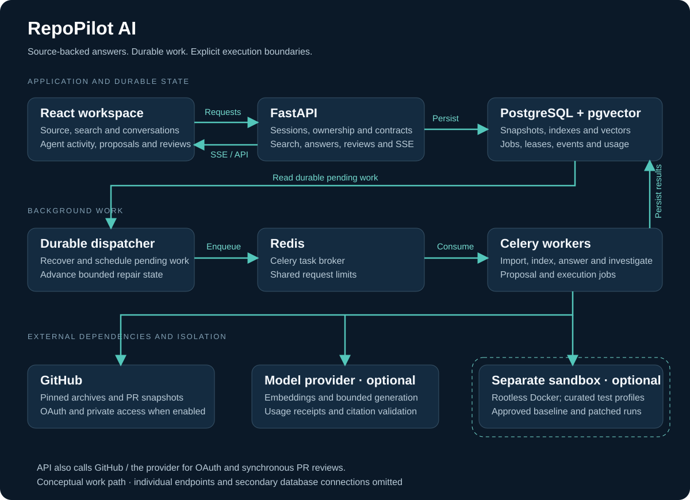

# Architecture

RepoPilot uses a React client and a modular FastAPI backend. Background workers
share the backend package, keeping business rules in one codebase while allowing
slow operations to run outside HTTP requests.

## Request and job flow

1. The browser calls same-origin `/api/` routes through Vite or nginx.
2. FastAPI authenticates the session, checks ownership, and validates the request.
3. PostgreSQL records durable work. The dispatcher schedules Celery tasks through Redis.
4. Workers claim jobs with expiring leases and publish results transactionally.
5. The browser reads saved state and reconnects to persisted events over SSE.

Unique request keys limit duplicate submissions. Lease and status checks prevent
stale or cancelled workers from publishing. Ambiguous paid calls are not retried
automatically; cancellation cannot guarantee that an external call incurs no charge.

## From repository to answer

Imports resolve a GitHub commit and retain bounded source snapshots. Python AST
and Tree-sitter TypeScript/TSX parsers extract symbols and chunks without executing
repository code. Unsupported syntax falls back to text with diagnostics.

Search combines keyword and symbol matches with optional pgvector semantic results
using reciprocal rank fusion. An optional local relevance scorer reranks results.
It is deterministic rather than a learned cross-encoder.

Answers use retrieved source as evidence. The backend validates structured output
and citation IDs, and saves completed answers with source snapshots. Named runs
include at most three recent answered pairs within a bounded context budget.
Streamed drafts stay provisional until the final response passes validation.

Refreshing a repository creates a new generation. Compatible unchanged parsing
and embedding inputs can be reused; saved conversations retain their original
provenance. Old generations remain until repository deletion.

## Investigation and validation

The agent has four read tools: search, file reading, symbol lookup, and literal
reference search. Each run is limited to five model calls. Typed edits must match
inspected source before the application produces a downloadable diff.

PR reviews save findings against immutable merge-base and head snapshots.
Approved patch validation sends a complete pinned archive to a separate rootless
Docker runner. Baseline and patched tests run in fresh containers. An authorized
repair loop allows up to two revisions and preserves attempts, usage, and stop reasons.

## Design choices

| Choice | Reason and tradeoff |
| --- | --- |
| React/Vite and FastAPI | A static client suits the authenticated workspace; FastAPI owns authorization and business rules. |
| PostgreSQL with pgvector | Source, metadata, vector search, and durable job state share transactional storage. |
| Explicit typed agent loop | A sequential five-call workflow stays inspectable without graph orchestration. |
| Versioned snapshots | Citations and saved results remain tied to exact source; retained generations consume storage. |
| Separate execution host | Repository tests run outside services that hold application credentials; containers still share a host kernel. |

## Code map

| Directory | Responsibility |
| --- | --- |
| `frontend/src/features/` | Authentication, repositories, search, conversations, agents, and validation UI |
| `frontend/src/lib/api/` | HTTP client and response validation |
| `backend/app/api/` | Routes and authentication dependencies |
| `backend/app/services/`, `repositories/`, `models/` | Business logic, database access, and persistence |
| `backend/app/jobs/` | Workers, leases, and durable dispatch |
| `backend/app/indexing/`, `retrieval/`, `generation/`, `agents/` | Code understanding and AI workflows |
| `backend/app/sandbox_runner/` | Separate execution controller and trusted harness |
| `backend/migrations/`, `backend/evaluation/` | Schema history and versioned evaluation fixtures |
| `deploy/`, `.github/workflows/` | Deployment, monitoring, and CI |
